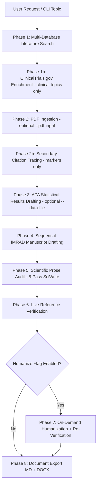
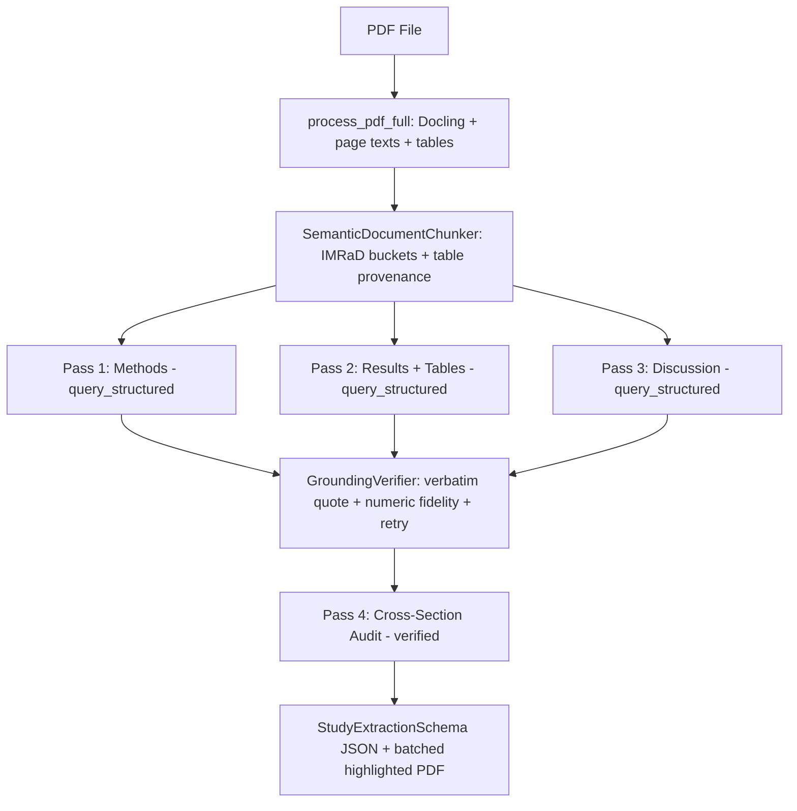
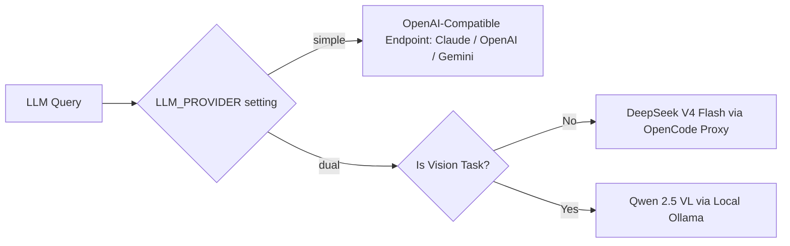

# MedDraft_AI — Architecture Specification

## System Overview

MedDraft_AI has two entry flows orchestrated by `main.py`:

**Flow A — Manuscript pipeline** (`python main.py --topic ...`):

**Flow B — Standalone zero-hallucination study extraction** (`python main.py --parse-pdf paper.pdf --out study.json --annotated-pdf proof.pdf`):

## Provider Routing Architecture

MedDraft_AI supports two execution pathways for language models:

## Module Structure

- `meddraft_ai.core`: Configuration management, LLM interface, provider routing, and the `SkillRegistry` that indexes prompt packs. `SkillRegistry.match_skill_for_task()` auto-routes task text to the most relevant skill (notably `secondary-citation-extractor` on `as cited in` / nested-citation signals); `get_skill_with_auto_routing()` falls back to routing when an exact name lookup fails.
- `meddraft_ai.search`: Multi-database APIs and Playwright stealth browser engine for Google Scholar. Hosts `clinicaltrials.py` (filtered ClinicalTrials.gov v2 search + NCT-ID lookup, no key) and `search_planner.py` (offline search-angle planner, word budgets, stalemate guard).
- `meddraft_ai.extraction`: Docling-based text/table extraction (`converter.py` → `ProcessedDocumentBundle`: markdown + `docling_doc` + 1-indexed `page_texts` + `tables_data`), `pdf_reader.py` (pdfplumber/pypdf fallback, `read_pages_dict()`), page-level citation anchoring (`pdf_annotator.py` batched highlights via `GroundingVerifier.save_annotated_pdf()`), plus `secondary_citation.SecondaryCitationExtractor` (4-step container→trace→verify→dual-attribution pipeline, auto-triggered by `ExtractionEngine` and `main.py` Phase 2b). Zero-hallucination study pipeline: `schemas.py` (`GroundedField`, `OutcomeMeasure`, `MethodsPassSchema`, `ResultsPassSchema`, `DiscussionPassSchema`, `CrossSectionAudit`, `StudyExtractionSchema`), `semantic_chunker.py` (`SemanticDocumentChunker`: IMRaD buckets + table provenance, Docling + text fallback), `grounding_verifier.py` (`GroundingVerifier`: verbatim-quote fuzzy match at 95%, numeric-token fidelity over values only, anti-evasion `UNCLEAR` rejection, downgrade-to-`UNCLEAR` valve, write-once annotation), `study_extractor.py` (`StudyExtractor`: 4 verified passes with self-correction retries via `LLMClient.query_structured()`), `extraction_engine.py` (`process_pdf_full()`: complete untruncated conversion + verified citations).
- `meddraft_ai.screening`: Standalone systematic-review toolkit — `parser.py` (RIS/CSV), `deduplicator.py`, `screener.py` (abstract), `fulltext_screener.py`, `prisma.py`. NOT part of the `main.py` manuscript pipeline (which does no dedup/screening/PRISMA); import it directly for systematic-review flows.
- `meddraft_ai.agents`: CoreWriter, Humanizer, VerifierAndStats, ProofReader, MedicalWriterAgent, plus `SecondaryCitationSpecialist` (carries the secondary-citation-extractor skill context for LLM-grounded tracing), `TrialsSpecialist` (ClinicalTrials.gov context), and `RebuttalSpecialist` (reviewer-response workflow context). `citation-integrity` and `surgical-word-reduction` feed CoreWriter/ProofReader; `academic-search-agent` feeds DeepResearchSpecialist; `medical-clinicaltrials` feeds ReferencesSpecialist. The 20 vendored Nature Paper Skills feed their assigned specialists by `<name>/SKILL.md` file path, and `load_context()` additionally preloads the query-relevant ones first (query-aware preload; neutral queries are byte-identical to before).
- `meddraft_ai.validation`: Live CrossRef and PubMed reference verification.
- `meddraft_ai.export`: Python-docx and Pandoc Markdown-to-DOCX conversion with publisher styles.

## Skill & Prompt Registry

Two skill layers feed the system:

- **Pipeline prompt packs** live in `meddraft_ai/prompts/`. The `SkillRegistry` (`meddraft_ai/core/skill_registry.py`) indexes every `.md`/`.txt` file at runtime; a new pack only needs its folder name added to `REGISTERED_PROMPT_SUBDIRS` in that module. `secondary-citation-extractor/` is registered there and additionally wired for automatic invocation via `AUTO_ROUTE_KEYWORDS` + `match_skill_for_task()`. Same pattern now covers `medical-clinicaltrials/`, `citation-integrity/`, `academic-search-agent/`, `surgical-word-reduction/`, and the 20-pack Nature Paper Skills layer (`meddraft_ai/core/nature_integration.py` + `match_skill_for_task()` chain hook; manifest at `meddraft_ai/prompts/nature-paper-skills/`).
- **Agent skills** live in `.agents/skills/` (guard skills for code/test/docs review plus the `thesis-master-guide` compliance skill and the `secondary-citation-extractor` tracing skill). They are pinned in `skills-lock.json` (`npx skills` lockfile format); `tests/test_skills_lock.py` enforces that every installed skill directory has a lock entry.

> **Two prompt mechanisms:** (1) Registry `.md`/`.txt` packs under `meddraft_ai/prompts/` (indexed at runtime; new folders must be added to `REGISTERED_PROMPT_SUBDIRS`). (2) `meddraft_ai/prompts/study_extraction_prompts.py` — Python string constants (`METHODS/RESULTS/DISCUSSION/SYNTHESIS_SYSTEM_PROMPT` + `CORE_GROUNDING_RULES`) imported directly by `StudyExtractor`; intentionally outside the registry because they are versioned code contracts for `LLMClient.query_structured()`, not retrievable prose.
